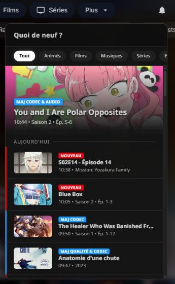

<h1 align="center">🔔 NotifySync</h1>

<p align="center">
  
  
  
  
  
  
  
</p>

<p align="center">
  <b>The modern notification center Jellyfin has been waiting for.</b><br>
  <i>Le centre de notifications moderne que Jellyfin attendait.</i>
</p>

<p align="center">
  
</p>

---

<p align="center">
  <b>🌐 Language / Langue</b><br>
  <a href="#english">English</a> | <a href="#français">Français</a>
</p>

---

<a name="english"></a>
# English

NotifySync transforms the Jellyfin interface by adding a native notification bell, inspired by major streaming platforms. Your users see the latest additions — Movies, Series, Music — without ever leaving their current page, through a sleek glass-morphism dropdown that feels like it was always part of Jellyfin.

> 📖 **Changelog & version history:** see [GitHub Releases](https://github.com/peterdu1109/NotifySync/releases) for what's new in each version.

## 📑 Table of Contents

- [🚀 Quick Start](#-quick-start)
- [✨ Key Features](#-key-features)
- [📦 Installation](#-installation)
- [⚙️ Configuration](#️-configuration)
- [❓ Troubleshooting](#-troubleshooting)
- [🎨 Recommended Theme](#-recommended-theme)
- [👥 Authors & Credits](#-authors--credits)

## 🚀 Quick Start

1. Add the NotifySync repository — one link for Jellyfin 12.x and 10.11.x, see [Installation](#-installation).
2. Install **NotifySync** from the Catalog → restart Jellyfin.
3. Install the **File Transformation** plugin to inject the bell automatically (see [Enable the Bell](#-enable-the-bell)).
4. In **Dashboard → Plugins → NotifySync**, check the libraries to monitor, **Save**, then click **Regenerate history** — nothing is announced until at least one library is checked.

That's it. The bell appears in the top-right header with your latest additions, and keeps up as new content arrives.

## ✨ Key Features

*   **Streaming-style bell** — A sleek glass dropdown with the latest addition as a large hero spotlight. The red counter clears when you open the bell; each item keeps a NEW / UPD badge until you dismiss it or it's played.
*   **Real-time** — Notifications arrive on their own, about half a minute after Jellyfin registers the content. No page refresh, ever.
*   **Organized by recency** — The list is split into **Today**, **This week**, and **Earlier** sections, newest first.
*   **Smart grouping** — Episodes grouped by series and labeled with the exact range that landed (`Season 4 • Ep. 1-12`, or `Ep. 1, 8` for a partial batch); tracks grouped by album.
*   **Upgrade detection** — Replace a media file and the notification comes back with a blue **UPD** badge telling you *what* changed: **Quality**, **Codec**, **Audio**, or a combination. Subtitle additions and metadata refreshes stay silent.
*   **Moves are not news** — Reorganising your libraries announces nothing new; a title already in the bell simply moves to its new category.
*   **Nothing half-drawn** — A title only appears once Jellyfin has identified it. No cards named after their folder, no missing artwork, no episodes waiting to be grouped.
*   **Favorites filter** — Favorite a series in Jellyfin and filter the bell down to just the content you care about.
*   **Filters & dismiss** — Quick category pills, dismiss per item or per group, swipe-left on mobile. Clearing the list never marks anything as "Played".
*   **Collections** — Monitored Jellyfin collections (BoxSets) notify you on new additions.
*   **Deletion history** — Admins get a log of recently deleted media, with configurable retention.
*   **Synced across devices** — Read and cleared states live on the server: phone and desktop always agree.
*   **Respects permissions** — Every user only ever sees content from libraries they can access, with strict per-user isolation.
*   **Bilingual & responsive** — French / English following your Jellyfin language, on desktop, tablet, and mobile.
*   **Remote-friendly on TV** — When your TV app shows the bell, the remote drives it: arrows to browse, OK to open or dismiss, Back to close.

## 📦 Installation

> [!IMPORTANT]
> **Prerequisites:**
> * Jellyfin **12.x** — or **10.11.x**, which stays on NotifySync 5.8.4.0
> * A web client — browser on desktop, tablet or phone, or the mobile app.
> * The **File Transformation** plugin, which adds the bell to the web client — or a manual edit of `index.html` (see [Enable the Bell](#-enable-the-bell)).
>
> 📺 **On TV:** TV apps ship their own interface, so the bell appears there only if the app loads NotifySync's script — Samsung TVs installed with [Apps2Samsung](https://github.com/Apps2Samsung/Apps2Samsung) do. The remote then drives it: arrows to browse, OK to open or dismiss, Back to close. Native apps such as Android TV cannot show it.

### Steps
1.  Open your Jellyfin dashboard > **Plugins** > **Repositories**.
2.  Add this repository — the same for Jellyfin 12.x and 10.11.x; Jellyfin picks the build made for your version:
    ```
    https://raw.githubusercontent.com/peterdu1109/NotifySync/refs/heads/main/repository.json
    ```
3.  Go to the **Catalog** and install **NotifySync**.
4.  Restart your Jellyfin server.

### 🔔 Enable the Bell

#### Method 1: File Transformation — recommended ✅

Automatic injection, no file to edit, and it **survives Jellyfin updates**.

1.  In **Dashboard → Plugins → Repositories**, add:
    ```
    https://www.iamparadox.dev/jellyfin/plugins/manifest.json
    ```
2.  Install **File Transformation** from the catalog.
3.  Restart Jellyfin, then `Ctrl+F5` in your browser.

#### Method 2: Manual Injection

> [!WARNING]
> This method requires re-applying the patch **after every Jellyfin update**, because Jellyfin overwrites `index.html`. Method 1 is strongly preferred.

If you prefer not to install another plugin, manually add the script tag to your `index.html`:

**Linux**
```bash
sudo sed -i 's|</body>|    <script src="/NotifySync/client.js"></script>\n</body>|' /usr/share/jellyfin/web/index.html
```

**Docker**
```bash
docker exec jellyfin sed -i 's|</body>|    <script src="/NotifySync/client.js"></script>\n</body>|' /jellyfin/jellyfin-web/index.html
```

**Windows** — open the web client's `index.html` in a text editor started as administrator:

```
C:\Program Files\Jellyfin\Server\jellyfin-web\index.html
```

and paste this line just before the closing `</body>`:

```html
<script src="/NotifySync/client.js"></script>
```


## ⚙️ Configuration

Go to **Dashboard > Plugins > NotifySync**.

| Setting | Default | Description |
|---------|---------|-------------|
| **Quota per Category** | `10` | Maximum number of **entries** per category (1–50). A whole series counts as one entry regardless of episode count (up to 500 episodes stored per series). |
| **Monitored Libraries** | *(none)* | Check the libraries you want to appear in the bell. |
| **Monitored Collections** | *(none)* | Select Jellyfin collections (BoxSets) to track for new additions. Scanned every 15 minutes. |
| **Category Mapping** | *(empty)* | Rename or group your libraries in the bell (e.g. *"My Movies"* → *"Movies"*). A library without a mapping shows under its own name. The arrows set the order of the bell's filters. |
| **Manual Selection (IDs or Names)** | *(empty)* | Add library IDs or names manually for advanced setups (Channels, XFusion). |
| **Enable deletion tracking** | `enabled` | Enable/disable the deletion history log. **Required for full UPD detection** on Sonarr/Radarr replacements (deleted, then re-imported). Replacements are correlated within a 7-day window. |
| **Retention (days)** | `30` | Number of days to keep deleted item records (7–365). The lower bound is 7 days so the detection window always has data — retention only controls how long the deletions stay visible in the admin log. |
| **Regenerate history** | — | Force a full rescan after changing libraries or categories. |
| **Scan collections now** | — | Force an immediate scan of monitored Collections instead of waiting for the automatic interval. |

## ❓ Troubleshooting

| Issue | Solution |
|-------|----------|
| **Bell doesn't appear** | Check **File Transformation** is installed. Restart Jellyfin. Hard refresh the browser (`Ctrl+F5`). |
| **No bell and `401 Unauthorized` errors in the browser console** | Your server runs Jellyfin 12 with the 10.11 build of NotifySync (5.x). Update NotifySync from the Catalog to 6.x, restart Jellyfin, then `Ctrl+F5`. |
| **Bell appeared then disappeared after Jellyfin update** | You're using Method 2 (manual injection) — re-apply the `sed` command. Switch to Method 1 (File Transformation) to avoid this. |
| **Badge count is wrong** | Click "Regenerate history" in config. Clear browser localStorage. |
| **Music not synced** | Use "Regenerate history" to rescan audio tracks. |
| **Content missing** | Make sure the library is checked in **Monitored Libraries**. |
| **New TV episode missing** | Make sure the **Series-type library** containing the episode is checked in **Monitored Libraries**. |
| **Replaced file shows NEW instead of UPD** | Turn on **Enable deletion tracking** in the settings — needed when a file is deleted, then re-imported. |
| **A renamed file shows a false UPD badge** | Renaming alone is recognised and stays silent. A badge can still slip through if the rename changed the file itself — dismiss it, and it will not come back. |
| **A moved series still shows as NEW** | Move detection needs **Enable deletion tracking** turned on, and it only recognises a folder that kept its name — moving *and* renaming in one go is indistinguishable from a deletion followed by an addition. |
| **Unauthorized content visible** | Plugin respects Jellyfin permissions — check user restrictions in the dashboard. |
| **429 Error** | Wait 30 seconds between "Regenerate history" clicks (anti-spam). |
| **Incompatible** | Use the repository from [Installation](#-installation) and update NotifySync from the Catalog — Jellyfin 12.x needs version 6.x or later. |

## 🎨 Recommended Theme

NotifySync pairs well with the [**ElegantFin Cinema Edition**](https://github.com/peterdu1109/ElegantFin) theme — a streaming-inspired CSS theme for Jellyfin with a full suite of cinematic modules.

Both work together on **PC (browser)**, **mobile (Jellyfin app + browser)** and **TV**.

> ⭐ Install once, get a complete cinematic Jellyfin experience with real-time notifications.

## 👥 Authors & Credits

NotifySync is maintained by:

- **[ElieMFR](https://github.com/ElieMFR)** — Original author & project lead
- **[Peterdu1109](https://github.com/peterdu1109)** — Co-maintainer

### 🙏 Contributors

<p><a href="https://github.com/muisje" title="@muisje"></a> <a href="https://github.com/Wernouxe" title="@Wernouxe"></a> <a href="https://github.com/hstark16" title="@hstark16"></a> <a href="https://github.com/Shillooh" title="@Shillooh"></a></p>

Contributions, bug reports, and feature requests are welcome on [GitHub](https://github.com/peterdu1109/NotifySync).

Released under the [MIT License](./LICENSE).

---

<a name="français"></a>
# Français

NotifySync transforme l'interface Jellyfin en y ajoutant une cloche de notifications native, inspirée des grandes plateformes de streaming. Vos utilisateurs voient les derniers ajouts — Films, Séries, Musique — sans jamais quitter leur page, via un menu déroulant en verre dépoli qui s'intègre naturellement dans Jellyfin.

> 📖 **Journal des versions :** voir les [Releases GitHub](https://github.com/peterdu1109/NotifySync/releases) pour les nouveautés de chaque version.

## 📑 Sommaire

- [🚀 Démarrage rapide](#-démarrage-rapide)
- [✨ Fonctionnalités](#-fonctionnalités)
- [📦 Installation](#-installation-1)
- [⚙️ Configuration](#️-configuration-1)
- [❓ Dépannage](#-dépannage)
- [🎨 Thème recommandé](#-thème-recommandé)
- [👥 Auteurs & Crédits](#-auteurs--crédits)

## 🚀 Démarrage rapide

1. Ajoutez le dépôt NotifySync — un seul lien pour Jellyfin 12.x et 10.11.x, voir [Installation](#-installation-1).
2. Installez **NotifySync** depuis le Catalogue → redémarrez Jellyfin.
3. Installez le plugin **File Transformation** pour injecter la cloche automatiquement (voir [Activer la cloche](#-activer-la-cloche)).
4. Dans **Tableau de bord → Extensions → NotifySync**, cochez les bibliothèques à surveiller, **Sauvegardez**, puis cliquez sur **Régénérer l'historique** — rien n'est annoncé tant qu'aucune bibliothèque n'est cochée.

C'est tout. La cloche apparaît en haut à droite de l'interface avec vos derniers ajouts, et suit les nouveautés au fil de l'eau.

## ✨ Fonctionnalités

*   **Cloche style streaming** — Un menu déroulant élégant en verre dépoli, avec le dernier ajout en grand en vedette. Le compteur rouge disparaît à l'ouverture ; chaque élément garde un badge NOUVEAU / MAJ jusqu'à ce que vous le retiriez ou qu'il soit marqué vu.
*   **Temps réel** — Les notifications arrivent seules, une trentaine de secondes après que Jellyfin a enregistré le contenu. Aucun rafraîchissement, jamais.
*   **Organisé par fraîcheur** — La liste est découpée en sections **Aujourd'hui**, **Cette semaine** et **Plus ancien**, du plus récent au plus ancien.
*   **Regroupement intelligent** — Épisodes groupés par série avec la plage exacte qui est arrivée (`Saison 4 • Ép. 1-12`, ou `Ép. 1, 8` pour un lot partiel) ; pistes groupées par album.
*   **Détection des mises à jour** — Remplacez un fichier média et la notification revient avec un badge bleu **MAJ** qui indique *ce qui* a changé : **Qualité**, **Codec**, **Audio**, ou une combinaison. Les ajouts de sous-titres et rafraîchissements de métadonnées restent silencieux.
*   **Un déplacement n'est pas une nouveauté** — Réorganiser vos bibliothèques n'annonce rien de neuf ; un titre déjà dans la cloche passe simplement dans sa nouvelle catégorie.
*   **Rien d'à moitié affiché** — Un titre n'apparaît qu'une fois identifié par Jellyfin. Plus de carte portant le nom de son dossier, plus d'affiche manquante, plus d'épisodes en attente de regroupement.
*   **Filtre Favoris** — Mettez une série en favori dans Jellyfin et filtrez la cloche sur les seuls contenus qui vous intéressent.
*   **Filtres & suppression** — Boutons de catégorie, suppression à l'unité ou par groupe, glisser vers la gauche sur mobile. Vider la liste ne marque jamais rien comme « Vu ».
*   **Collections** — Les collections Jellyfin surveillées (BoxSets) vous notifient des nouveaux ajouts.
*   **Historique des suppressions** — Les admins disposent d'un journal des médias récemment supprimés, avec rétention paramétrable.
*   **Synchronisé entre appareils** — États lu / vidé stockés côté serveur : téléphone et bureau toujours d'accord.
*   **Respecte les permissions** — Chaque utilisateur ne voit que le contenu des bibliothèques auxquelles il a accès, avec une isolation stricte par utilisateur.
*   **Bilingue & adaptée à tous les écrans** — Français / Anglais selon la langue de votre Jellyfin, sur ordinateur, tablette et mobile.
*   **À la télécommande sur télé** — Quand votre application TV affiche la cloche, la télécommande la pilote : flèches pour parcourir, OK pour ouvrir ou retirer, Retour pour fermer.

## 📦 Installation

> [!IMPORTANT]
> **Pré-requis :**
> * Jellyfin **12.x** — ou **10.11.x**, qui reste en NotifySync 5.8.4.0
> * Un client web — navigateur sur ordinateur, tablette ou téléphone, ou l'application mobile.
> * L'extension **File Transformation**, qui ajoute la cloche au client web — ou une modification manuelle de `index.html` (voir [Activer la cloche](#-activer-la-cloche)).
>
> 📺 **Sur TV :** les applications TV embarquent leur propre interface : la cloche n'y apparaît que si l'application charge le script de NotifySync — c'est le cas des TV Samsung installées avec [Apps2Samsung](https://github.com/Apps2Samsung/Apps2Samsung). Elle se pilote alors à la télécommande : flèches pour parcourir, OK pour ouvrir ou retirer, Retour pour fermer. Les applications natives comme Android TV ne peuvent pas l'afficher.

### Étapes
1.  Tableau de bord Jellyfin > **Extensions** > **Dépôts**.
2.  Ajoutez ce dépôt — le même pour Jellyfin 12.x et 10.11.x ; Jellyfin choisit la version faite pour la vôtre :
    ```
    https://raw.githubusercontent.com/peterdu1109/NotifySync/refs/heads/main/repository.json
    ```
3.  Allez dans le **Catalogue** et installez **NotifySync**.
4.  Redémarrez votre serveur Jellyfin.

### 🔔 Activer la cloche

#### Méthode 1 : File Transformation — recommandée ✅

Injection automatique, aucun fichier à modifier, et ça **survit aux mises à jour de Jellyfin**.

1.  Dans **Tableau de bord → Extensions → Dépôts**, ajoutez :
    ```
    https://www.iamparadox.dev/jellyfin/plugins/manifest.json
    ```
2.  Installez **File Transformation** depuis le catalogue.
3.  Redémarrez Jellyfin, puis `Ctrl+F5` dans votre navigateur.

#### Méthode 2 : Injection manuelle

> [!WARNING]
> Cette méthode nécessite de **ré-appliquer le patch après chaque mise à jour Jellyfin**, car Jellyfin écrase `index.html`. La Méthode 1 est fortement recommandée.

Si vous préférez ne pas installer d'extension tierce :

**Linux**
```bash
sudo sed -i 's|</body>|    <script src="/NotifySync/client.js"></script>\n</body>|' /usr/share/jellyfin/web/index.html
```

**Docker**
```bash
docker exec jellyfin sed -i 's|</body>|    <script src="/NotifySync/client.js"></script>\n</body>|' /jellyfin/jellyfin-web/index.html
```

**Windows** — ouvrez le `index.html` du client web dans un éditeur lancé en administrateur :

```
C:\Program Files\Jellyfin\Server\jellyfin-web\index.html
```

et collez cette ligne juste avant la balise `</body>` :

```html
<script src="/NotifySync/client.js"></script>
```


## ⚙️ Configuration

Allez dans **Tableau de bord > Extensions > NotifySync**.

| Paramètre | Défaut | Description |
|-----------|--------|-------------|
| **Quota par catégorie** | `10` | Nombre maximum d'**entrées** par catégorie (1–50). Une série entière compte pour une seule entrée, quel que soit le nombre d'épisodes (jusqu'à 500 épisodes stockés par série). |
| **Bibliothèques surveillées** | *(aucune)* | Cochez les bibliothèques que vous souhaitez voir apparaître dans la cloche. |
| **Collections surveillées** | *(aucune)* | Sélectionnez les collections Jellyfin (BoxSets) à surveiller pour les nouveaux ajouts. Scannées toutes les 15 minutes. |
| **Mappage des catégories** | *(vide)* | Renommez ou regroupez vos bibliothèques dans la cloche (ex. *"Mes Films"* → *"Films"*). Une bibliothèque sans mappage garde son propre nom. Les flèches fixent l'ordre des filtres de la cloche. |
| **Sélection manuelle (IDs ou noms)** | *(vide)* | Ajoutez des IDs ou noms de bibliothèques manuellement pour les configurations avancées (Channels, XFusion). |
| **Activer le suivi des suppressions** | `activé` | Activer/désactiver le journal des suppressions. **Requis pour la détection MAJ complète** sur les remplacements Sonarr/Radarr (suppression puis réimport). Les remplacements sont corrélés dans une fenêtre de 7 jours. |
| **Rétention (jours)** | `30` | Nombre de jours de conservation des éléments supprimés (7–365). La borne basse est de 7 jours pour que la fenêtre de détection ait toujours des données — la rétention ne fait que prolonger l'affichage dans le journal admin. |
| **Régénérer l'historique** | — | Force un scan complet après modification des bibliothèques ou des catégories. |
| **Scanner les collections** | — | Force un scan immédiat des Collections surveillées au lieu d'attendre l'intervalle automatique. |

## ❓ Dépannage

| Problème | Solution |
|----------|----------|
| **La cloche n'apparaît pas** | Vérifiez que **File Transformation** est installé. Redémarrez Jellyfin. Rechargez le navigateur sans cache (`Ctrl+F5`). |
| **Pas de cloche et des erreurs `401 Unauthorized` dans la console du navigateur** | Votre serveur est en Jellyfin 12 avec la version 10.11 de NotifySync (5.x). Mettez NotifySync à jour en 6.x depuis le Catalogue, redémarrez Jellyfin, puis `Ctrl+F5`. |
| **La cloche a disparu après mise à jour Jellyfin** | Vous utilisez la Méthode 2 (injection manuelle) — ré-appliquez la commande `sed`. Passez à la Méthode 1 (File Transformation) pour éviter ça. |
| **Le badge est incorrect** | Cliquez sur "Régénérer l'historique". Videz le localStorage du navigateur. |
| **Musique non synchronisée** | Utilisez "Régénérer l'historique" pour rescanner les pistes audio. |
| **Contenu manquant** | Vérifiez que la bibliothèque est cochée dans **Bibliothèques surveillées**. |
| **Nouvel épisode TV manquant** | Vérifiez que la **bibliothèque de type Série** contenant l'épisode est cochée dans **Bibliothèques surveillées**. |
| **Un fichier remplacé apparaît en NOUVEAU au lieu de MAJ** | Cochez **Activer le suivi des suppressions** dans les réglages — nécessaire quand un fichier est supprimé puis réimporté. |
| **Un fichier renommé affiche un faux badge MAJ** | Un simple renommage est reconnu et reste silencieux. Un badge ne peut subsister que si le renommage a aussi modifié le fichier — retirez la notification, elle ne reviendra pas. |
| **Une série déplacée apparaît quand même en NOUVEAU** | La détection nécessite **Activer le suivi des suppressions**, et elle ne reconnaît qu'un dossier ayant conservé son nom — déplacer *et* renommer en une fois est indistinguable d'une suppression suivie d'un ajout. |
| **Contenu non autorisé visible** | Le plugin respecte les permissions Jellyfin — vérifiez les restrictions utilisateur. |
| **Erreur 429** | Attendez 30 secondes entre chaque clic sur "Régénérer l'historique" (anti-spam). |
| **Incompatible** | Utilisez le dépôt de l'[Installation](#-installation-1) et mettez NotifySync à jour depuis le Catalogue — Jellyfin 12.x demande la version 6.x ou plus. |

## 🎨 Thème recommandé

NotifySync se marie bien avec le thème [**ElegantFin Cinema Edition**](https://github.com/peterdu1109/ElegantFin) — un thème CSS inspiré des plateformes de streaming pour Jellyfin avec une suite complète de modules cinématographiques.

Les deux fonctionnent ensemble sur **PC (navigateur)**, **mobile (app Jellyfin + navigateur)** et **TV**.

> ⭐ Installation unique, expérience Jellyfin cinéma complète avec notifications temps réel.

## 👥 Auteurs & Crédits

NotifySync est maintenu par :

- **[ElieMFR](https://github.com/ElieMFR)** — Auteur original & responsable du projet
- **[Peterdu1109](https://github.com/peterdu1109)** — Co-mainteneur

### 🙏 Contributeurs

<p><a href="https://github.com/muisje" title="@muisje"></a> <a href="https://github.com/Wernouxe" title="@Wernouxe"></a> <a href="https://github.com/hstark16" title="@hstark16"></a> <a href="https://github.com/Shillooh" title="@Shillooh"></a></p>

Contributions, rapports de bugs et demandes de fonctionnalités sont les bienvenus sur [GitHub](https://github.com/peterdu1109/NotifySync).

Distribué sous [Licence MIT](./LICENSE).
